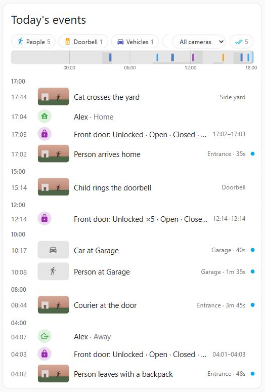
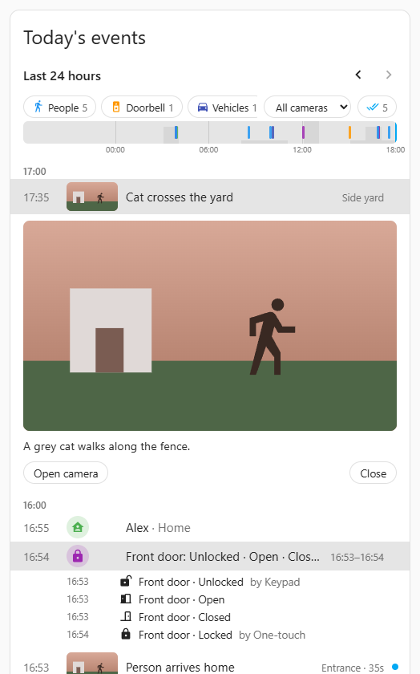
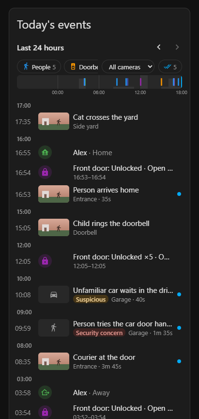

# Event Reel Card

A Home Assistant dashboard card that shows **one compact timeline of the day's events**:

- door, lock and presence changes, grouped so one entry is one row
  (`Front door: Unlocked · Open · Closed · Locked`)
- camera activity with **animated previews** and the **exact recorded clip** from
  [Frigate](https://frigate.video), played inline
- AI descriptions from [LLM Vision](https://github.com/valentinfrlch/ha-llmvision) (and
  Frigate GenAI review summaries), merged with the matching video
- Nest doorbell clips for doorbell events analysed by LLM Vision
- any event you log yourself

[](https://my.home-assistant.io/redirect/hacs_repository/?owner=oddhus&repository=event-reel-card&category=plugin)

<p>
  
</p>

> **Status:** early release. Versions follow [Semantic Versioning](https://semver.org/);
> while the version is 0.x, options may still change between minor versions (see the
> [changelog](CHANGELOG.md)). The design and roadmap are in [PLAN.md](PLAN.md).

## Features

- **Compact by default.** Bursts of door and lock changes collapse into one row, a
  bouncing lock collapses into `Unlocked ×5`, and runs of camera events on the same camera
  group into `3× Entrance`.
- **Video first.** Camera rows show a muted, looping preview while they're on screen (at
  most six at once). Tap a row to play the exact clip over HLS, widen it by ±30 s, or
  download it.
- **One row per moment.** An AI description and the Frigate review it belongs to become one
  row. A second description of the same visit shows inside that row.
- **Filters and overview.** Category chips, a camera menu and a 24-hour strip you can tap,
  drag or step through with the arrow keys.
- **Earlier days.** Step back a day at a time with ‹ and ›, and jump back to today.
- **Mark reviewed.** Mark one Frigate review, or all visible ones, as reviewed.
- **Deep links.** `?reel=<id>` opens an event, so a notification can link straight to the
  clip.
- **Visual editor** for the common options; everything else in YAML.
- **English and Norwegian (bokmål)**, following your Home Assistant language.

## Screenshots

| Details | Phone, dark theme |
|---|---|
|  |  |

Tap a camera row to play the exact clip; tap a door row to see each step and who did it.

## What it needs

The card is frontend only. It uses what Home Assistant already exposes, and every
integration beyond core is optional:

| Source | Needs | Adds |
|---|---|---|
| Entities | Home Assistant only (logbook and history) | Door, lock, presence and other state changes |
| Frigate | The [Frigate integration](https://github.com/blakeblackshear/frigate-hass-integration) | Review items, animated previews, exact clips, mark reviewed |
| LLM Vision | [LLM Vision](https://github.com/valentinfrlch/ha-llmvision) with the timeline enabled | AI titles and descriptions |
| Nest | The Nest integration (core) | Doorbell clips for LLM Vision doorbell events |

The card detects what is installed. Sources you haven't configured and don't have are
skipped quietly. A source you configured explicitly shows a warning chip if it's missing.

## Installation

You need Home Assistant 2024.11 or newer.

### With HACS (recommended)

1. Make sure [HACS](https://hacs.xyz) is installed.
2. Click the button below. It opens HACS on your own Home Assistant with this repository
   selected:

   [](https://my.home-assistant.io/redirect/hacs_repository/?owner=oddhus&repository=event-reel-card&category=plugin)

   If the button doesn't work, add it by hand: in HACS, open the menu (⋮) →
   **Custom repositories**, enter `https://github.com/oddhus/event-reel-card`, choose the
   type **Dashboard** and click **Add**. Then search for **Event Reel Card**.
3. Click **Download**, and pick the latest version.
4. Reload the browser (or, in the Companion app, **Settings → Companion app → Reset
   frontend cache**). HACS adds the dashboard resource for you.
5. Add the card: edit a dashboard, **Add card**, search for **Event Reel**. The card
   suggests your locks, door sensors and people; adjust them in the editor.

HACS tells you when a new version is out; updating is one click.

### Manual

1. Download `event-reel-card.js` from the
   [latest release](https://github.com/oddhus/event-reel-card/releases/latest).
2. Copy it to `config/www/event-reel-card.js` (create the `www` folder if needed).
3. Add a dashboard resource: **Settings → Dashboards → ⋮ → Resources → Add resource**,
   URL `/local/event-reel-card.js?v=0.2.1`, type **JavaScript module**.
4. Reload the browser and add the card as above.

When you update by hand, change the `?v=` part of the resource URL too; `/local/` files
are cached for a long time.

## Configuration

The smallest useful card:

```yaml
type: custom:event-reel-card
entities:
  - lock.front_door
  - binary_sensor.front_door
  - person.alex
```

Frigate and LLM Vision are picked up automatically when they're installed.

A fuller example:

```yaml
type: custom:event-reel-card
title: Today
range: 24h
language: auto
entities:
  - entity: lock.front_door
    name: Front door
    actor_attribute: changed_by    # show who locked it, from the lock's attribute
  - entity: binary_sensor.front_door
    name: Front door
    states: { "on": Opened, "off": Closed }
  - person.alex
  - person.sam
llmvision:
  non_camera: false                # see "Running next to an automation" below
frigate:
  show_unmatched: true
  severity: [alert, detection]
camera_aliases:
  camera.backyard_reolink: camera.backyard
cameras:
  camera.entrance: { clip: auto }  # or `preview` to skip the full-quality stream
```

### Options

| Option | Default | Description |
|---|---|---|
| `title` | none | Card title. |
| `range` | `24h` | `24h` (rolling), `today`, or a number of hours such as `12h`. |
| `density` | `compact` | `compact` or `comfortable` (bigger previews, two-line descriptions). |
| `preview` | `visible` | Animated previews: `visible`, `hover`, `still` or `off`. |
| `language` | `auto` | `auto` (your HA language), `en` or `nb`. |
| `max_events` | `200` | Most events to show. |
| `refresh_interval` | `60` | Seconds between refreshes while the card is visible. |
| `filters` | `true` | Show the category chips and camera menu. |
| `day_strip` | `true` | Show the 24-hour strip. |
| `day_navigation` | `true` | Show the ‹ › buttons for earlier days. A past day runs from midnight to midnight. How far back it finds events depends on how long each source keeps them; the recorder keeps 10 days by default. |
| `entities` | none | Entities whose state changes appear. An item is an entity id or an object with `entity`, `name`, `icon`, `category`, `states` (labels per state), `only_states` and `actor_attribute`. |
| `llmvision` | auto | `true`, `false`, or an object with `non_camera` (default `true`), `categories` and `enabled`. |
| `frigate` | auto | `true`, `false`, or an object with `cameras` (`auto` or a list), `severity` (default `[alert, detection]`), `show_unmatched` (default `true`), `hide_unconfirmed` (default `false`), `clip_padding` (default `[10, 20]` seconds) and `enabled`. |
| `nest` | auto | `true` or `false`. Used for doorbell clips. |
| `camera_aliases` | none | Maps another camera entity (or an LLM Vision camera name) to a canonical camera, e.g. a Reolink entity to the Frigate camera of the same device. |
| `cameras` | none | Per camera entity: `name`, and `clip: auto` or `preview`. |
| `grouping.window` | `120` | Seconds between events that still group into one row. |
| `merge.before` / `merge.after` | `15` / `30` | How far (seconds) an AI event may lie before the start or after the end of a Frigate review and still be merged with it. |

`enabled: false` inside a provider object switches it off but keeps its options; the visual
editor writes that.

### Running next to an automation

If an automation already copies door, lock or presence changes into the LLM Vision
timeline with `llmvision.create_event`, list those entities under `entities:` and set
`llmvision: { non_camera: false }`. Otherwise each change shows twice.

## Register your own events

From easiest to most powerful:

1. **Add the entity to `entities:`.** Every state change shows up, with no automation.
2. **`logbook.log`** from any automation, for an entity listed under `entities:`. The entry
   appears with your name and message. It's kept as long as the recorder keeps data
   (10 days by default).

   ```yaml
   action: logbook.log
   data:
     entity_id: binary_sensor.mailbox
     name: Mailbox
     message: Post arrived
   ```

3. **`llmvision.create_event`**, which is stored permanently in the LLM Vision timeline.
   It shows as long as `llmvision.non_camera` is `true` (the default).

   ```yaml
   action: llmvision.create_event
   data:
     title: Package delivered
     description: A package was left by the door.
   ```

## Deep links

Add `?reel=<id>` to the dashboard URL to open one event. `<id>` can be a Frigate review id
or an LLM Vision event uid. For example, a notification for a Frigate review:

```yaml
action: notify.mobile_app_phone
data:
  title: Someone at the door
  message: Tap to watch the clip
  data:
    url: "/dashboard-home/today?reel={{ trigger.payload_json['after']['id'] }}"
    clickAction: "/dashboard-home/today?reel={{ trigger.payload_json['after']['id'] }}"
```

(with an MQTT trigger on `frigate/reviews`). If the event isn't in the card's time range,
the card says so.

## Troubleshooting

**"Full quality uses H.265 …"** Some cameras record H.265 (HEVC), which not every browser
can play. The card then shows Frigate's low-resolution preview and offers the download.
Set `cameras: { camera.x: { clip: preview } }` to skip the attempt for a camera.

**"The recording has been deleted."** The clip is older than your Frigate recording
retention.

**No animated previews, only stills.** Previews come through the Frigate integration's
notification proxy. If you disabled that option in the integration, the card falls back
to still images.

**A doorbell event has no clip.** Doorbell clips need the Nest integration, and the LLM
Vision event must have been created from the Nest attachment (`video_analyzer` on
`trigger.event.data.attachment.video`).

**The card didn't change after an update.** Bump the `?v=` on the resource URL (manual
installs), or reload the frontend cache. In the Companion app: **Settings → Companion
app → Reset frontend cache**.

**Clips take a few seconds to start.** Full-quality 4K segments are large. The card loops
the preview until the clip plays.

## Development

```bash
npm install
npm run dev     # dev harness with a mock hass at http://localhost:5173
npm test
npm run lint
npm run build   # dist/event-reel-card.js
```

The dev harness uses generated example data. With `FRIGATE_URL` in `.env.local` and
`?live=1`, it plays real Frigate media through a dev proxy. See [PLAN.md](PLAN.md) §7.

## Contributing

Contributions are welcome, including ones written with AI coding agents. Read
[CONTRIBUTING.md](CONTRIBUTING.md) before opening a PR; agents follow
[AGENTS.md](AGENTS.md).

## Privacy

The card runs in your browser and talks only to your own Home Assistant. Media URLs are
signed by Home Assistant and expire.

## License

MIT
